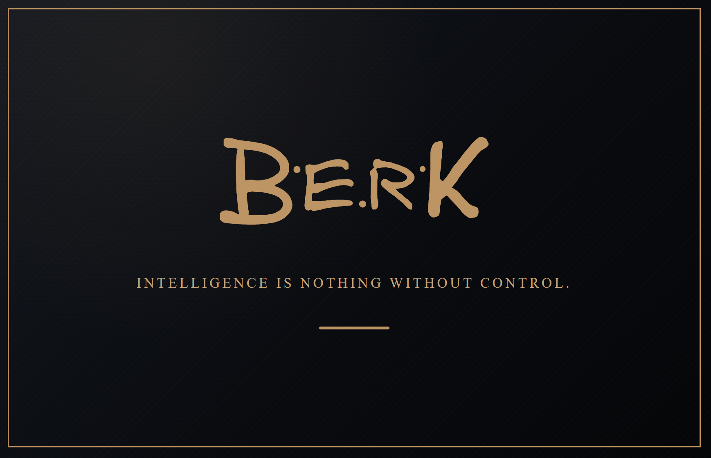

<picture><source media="(max-width: 600px)" srcset="assets/hero-mobile.webp"></picture>
EN
### A different vantage point on systems

I see technology through the realities it has to serve. **For more than two decades, my work has moved between retail, hospitality, logistics, supply chain and aviation-related operations** — including settings where reliability, discretion and precise coordination are essential.

These environments taught me to look beyond isolated tasks. A decision at one point of a system changes the workload, risk, timing and experience somewhere else. Understanding those dependencies — human, physical, commercial and technical — is the starting point of how I think.

### How I approach complexity

I have worked on operational transformations, built and stabilised processes and carried responsibility for teams of up to **140 people**. That experience shapes the questions I ask before discussing a solution:

**What happens in reality? What depends on what? Where does friction emerge? Which controls make the result repeatable?**

The same thinking now informs my own digital concepts: structured scheduling and capacity allocation, operational workflows, information flows, traceability and practical decision support. The goal is not technology for its own sake, but systems people can understand, operate and improve.

### Where operations meet software

I am adding hands-on software engineering to this operational foundation. My current work includes **HTML, CSS, JavaScript and Git**; my full-stack learning extends across **Angular, React, TypeScript, Python, Django, APIs and data-driven applications**. This is an active development journey — not a claim that every technology is already mastered.

What interests me most is the connection between **real-world constraints** and **clear digital architecture**: translating operational behaviour into interfaces, rules and workflows that remain usable when complexity increases.

----
DE
### Ein anderer Blickwinkel auf Systeme

Ich sehe Technologie durch die Realitäten, denen sie dienen muss. Seit mehr als zwei Jahrzehnten bewegt sich meine Arbeit zwischen Einzelhandel, Gastgewerbe, Logistik, Lieferkette und luftfahrtbezogenen Betrieben – einschließlich Umgebungen, in denen Zuverlässigkeit, Diskretion und präzise Koordination unerlässlich sind.

Diese Umgebungen haben mich gelehrt, über isolierte Aufgaben hinauszublicken. Eine Entscheidung an einer Stelle eines Systems verändert Arbeitsbelastung, Risiko, Timing und Erfahrung an einer anderen Stelle. Das Verständnis dieser Abhängigkeiten – menschlich, physisch, kommerziell und technisch – ist der Ausgangspunkt meines Denkens.

Wie ich Komplexität angehe
Ich habe an betrieblichen Transformationen gearbeitet, Prozesse aufgebaut und stabilisiert und Verantwortung für Teams von bis zu 140 Personen getragen. Diese Erfahrung prägt die Fragen, die ich stelle, bevor ich über eine Lösung diskutiere:

Was passiert in der Realität? Was hängt von was ab? Wo entsteht Reibung? Welche Kontrollen machen das Ergebnis wiederholbar?

Dasselbe Denken prägt nun meine eigenen digitalen Konzepte: strukturierte Terminplanung und Kapazitätszuweisung, betriebliche Arbeitsabläufe, Informationsflüsse, Rückverfolgbarkeit und praktische Entscheidungsunterstützung. Das Ziel ist nicht Technologie um ihrer selbst willen, sondern Systeme, die Menschen verstehen, bedienen und verbessern können.

Wo Betrieb auf Software trifft
Ich ergänze diese operative Grundlage durch praktische Softwareentwicklung. Meine aktuelle Arbeit umfasst HTML, CSS, JavaScript und Git; mein Full-Stack-Lernen erstreckt sich über Angular, React, TypeScript, Python, Django, APIs und datengesteuerte Anwendungen. Dies ist eine aktive Entwicklungsreise – keine Behauptung, dass jede Technologie bereits beherrscht wird.

Am meisten interessiert mich die Verbindung zwischen realen Einschränkungen und klarer digitaler Architektur: die Übersetzung operativen Verhaltens in Schnittstellen, Regeln und Arbeitsabläufe, die bei zunehmender Komplexität nutzbar bleiben.

----
TR
### Sistemlere farklı bir bakış açısı
Teknolojiyi, hizmet etmek zorunda olduğu gerçeklikler üzerinden görüyorum. Yirmi yılı aşkın süredir çalışmalarım perakende, konaklama, lojistik, tedarik zinciri ve havacılıkla ilgili operasyonlar arasında geçti — güvenilirliğin, gizliliğin ve hassas koordinasyonun vazgeçilmez olduğu ortamlar dahil.

Bu ortamlar bana izole görevlerin ötesine bakmayı öğretti. Bir sistemin bir noktasındaki karar, başka bir noktadaki iş yükünü, riski, zamanlamayı ve deneyimi değiştirir. Bu bağımlılıkları — insani, fiziksel, ticari ve teknik — anlamak, düşünme biçimimin başlangıç noktasıdır.

Karmaşıklığa nasıl yaklaşıyorum
Operasyonel dönüşümler üzerinde çalıştım, süreçler kurdum ve stabilize ettim ve 140 kişiye kadar ekiplerin sorumluluğunu üstlendim. Bu deneyim, bir çözümü tartışmadan önce sorduğum soruları şekillendiriyor:

Gerçekte ne oluyor? Ne neye bağlı? Sürtünme nerede ortaya çıkıyor? Hangi kontroller sonucu tekrarlanabilir kılıyor?

Aynı düşünce artık kendi dijital konseptlerimi de yönlendiriyor: yapılandırılmış zamanlama ve kapasite tahsisi, operasyonel iş akışları, bilgi akışları, izlenebilirlik ve pratik karar desteği. Amaç, teknolojinin kendi başına bir amaç olması değil, insanların anlayabileceği, işletebileceği ve geliştirebileceği sistemlerdir.

Operasyonun yazılımla buluştuğu yer
Bu operasyonel temele uygulamalı yazılım mühendisliği ekliyorum. Mevcut çalışmalarım HTML, CSS, JavaScript ve Git'i kapsıyor; full-stack öğrenimim Angular, React, TypeScript, Python, Django, API'ler ve veri odaklı uygulamalar boyunca uzanıyor. Bu aktif bir gelişim yolculuğu — her teknolojinin zaten ustalaşıldığı iddiası değil.

Beni en çok ilgilendiren şey, gerçek dünya kısıtlamaları ile net dijital mimari arasındaki bağlantı: operasyonel davranışı, karmaşıklık arttığında bile kullanılabilir kalan arayüzlere, kurallara ve iş akışlarına dönüştürmek.

*Intelligence is nothing without control.*

[Email](mailto:berk.mustafa@outlook.de) · [GitHub](https://github.com/berk-dev385)
