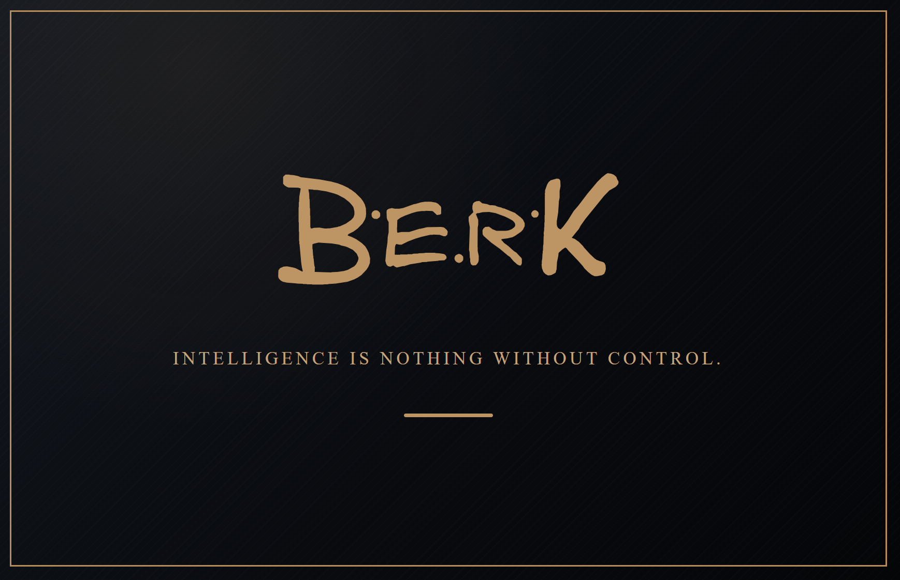

<picture><source media="(max-width: 600px)" srcset="assets/hero-mobile.webp"></picture>

### A different vantage point on systems

I see technology through the realities it has to serve. **For more than two decades, my work has moved between retail, hospitality, logistics, supply chain and aviation-related operations** — including settings where reliability, discretion and precise coordination are essential.

These environments taught me to look beyond isolated tasks. A decision at one point of a system changes the workload, risk, timing and experience somewhere else. Understanding those dependencies — human, physical, commercial and technical — is the starting point of how I think.

### How I approach complexity

I have worked on operational transformations, built and stabilised processes and carried responsibility for teams of up to **140 people**. That experience shapes the questions I ask before discussing a solution:

**What happens in reality? What depends on what? Where does friction emerge? Which controls make the result repeatable?**

The same thinking now informs my own digital concepts: structured scheduling and capacity allocation, operational workflows, information flows, traceability and practical decision support. The goal is not technology for its own sake, but systems people can understand, operate and improve.

### Where operations meet software

I am adding hands-on software engineering to this operational foundation. My current work includes **HTML, CSS, JavaScript and Git**; my full-stack learning extends across **Angular, React, TypeScript, Python, Django, APIs and data-driven applications**. This is an active development journey — not a claim that every technology is already mastered.

What interests me most is the connection between **real-world constraints** and **clear digital architecture**: translating operational behaviour into interfaces, rules and workflows that remain usable when complexity increases.

---

*Intelligence is nothing without control.*

[Email](mailto:berk.mustafa@outlook.de) · [GitHub](https://github.com/berk-dev385)
