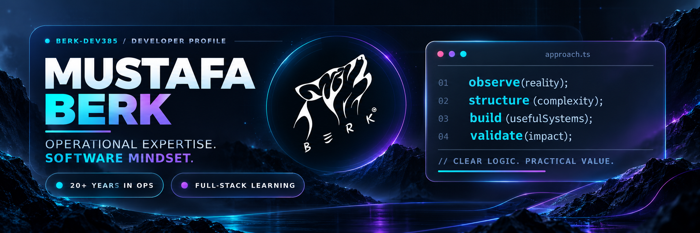
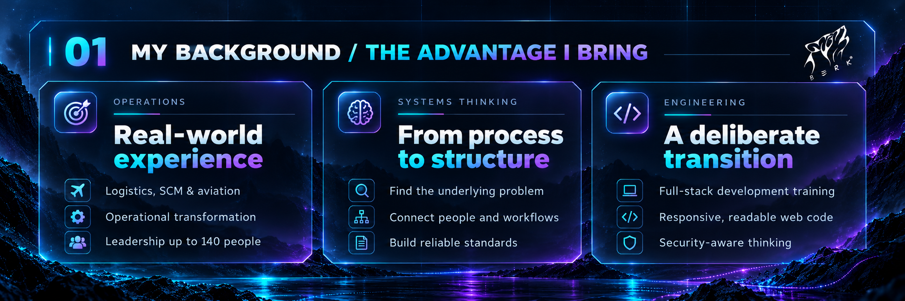
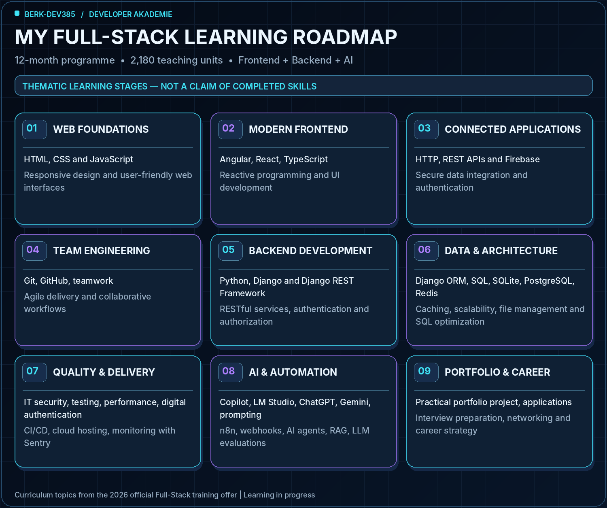
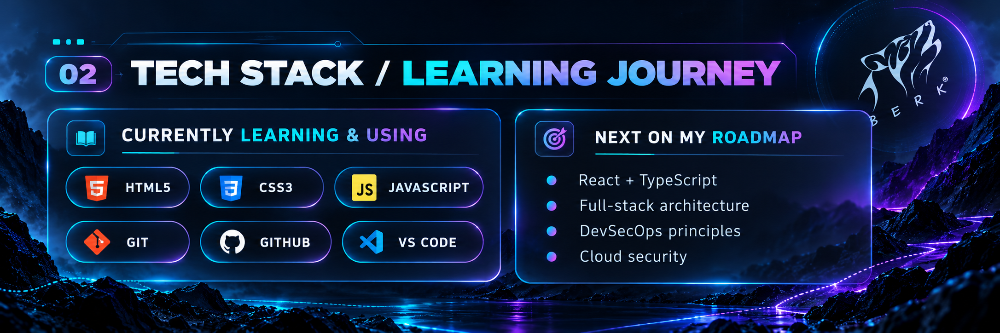
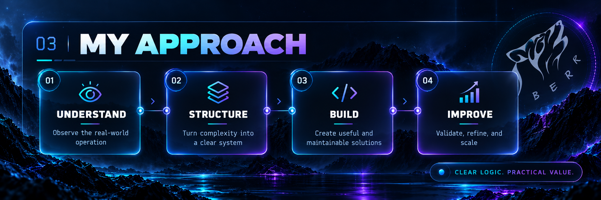

<!--
GitHub profile README for berk-dev385. All image links are local and complete.
Graphic panels use static PNGs to display correctly within GitHub's CSS restrictions.
The roadmap describes the OFFICIAL TRAINING CURRICULUM, not completed competencies.
The training offer provides topics, but no official module-by-module timetable.
-->

<picture><source media="(max-width: 600px)" srcset="./assets/hero-mobile.png"></picture>

<h3 align="center">From operational reality to purposeful software.</h3>

<strong>Logistics &amp; Supply Chain · Aviation · Operational Excellence · Full-Stack Engineering</strong>

I'm **Mustafa Berk**. For more than **20 years**, I've worked where people, processes and complex operations come together, across logistics, supply chain management and aviation-related environments. My experience includes operational transformations, project leadership and responsibility for teams of **up to 140 people**.

I'm now building a second professional discipline through a **12-month full-stack software development programme at Developer Akademie**, combining **frontend, backend, AI-supported development and workflow automation**. I'm documenting the process here as a learning journey — not presenting planned skills as completed qualifications.

<picture><source media="(max-width: 600px)" srcset="./assets/experience-mobile.png"></picture>

## The learning journey

This programme covers **12 months · 2,180 teaching units · online full-time learning**. Below is my complete curriculum-based roadmap. Its stages are arranged by technical dependency to make the story easy to follow; **they are not an official weekly timetable or a claim of completed mastery**.

<picture><source media="(max-width: 600px)" srcset="./assets/roadmap-mobile.png"></picture>

### 01 / Frontend development

The client-side foundations and frameworks of the programme:

- **Web foundations:** HTML, CSS and JavaScript for modern web development.
- **Modern frameworks and languages:** Angular, React and TypeScript, including **reactive programming**.
- **Responsive interface design:** techniques for user-friendly experiences across screen sizes.
- **Frontend data integration:** practical API integration and handling HTTP requests.
- **Version control and teamwork:** Git/GitHub, collaborative development and agile working methods.
- **Firebase:** secure database integration and user authentication.
- **Engineering best practices:** web application security, testing and performance optimization.

### 02 / Backend engineering

The server-side and data foundations extend the frontend into full-stack applications:

- **Architecture:** backend fundamentals and internet architecture.
- **Python & Django:** application development with Python and the Django framework.
- **RESTful services:** designing and implementing APIs with **Django REST Framework**.
- **Access control:** Django-based authentication and authorization.
- **Data layer:** Django ORM; **SQLite, PostgreSQL and Redis**.
- **Database engineering:** SQL fundamentals and database optimization.
- **Advanced backend concepts:** caching, scalability and file management.
- **Deployment and delivery:** version control, CI/CD pipelines and cloud hosting.
- **Observability:** application error monitoring and performance analysis with **Sentry**.

### 03 / AI-assisted development & workflow automation

AI is part of the official full-stack curriculum, not an unrelated side topic:

- **AI-assisted coding:** LM Studio, GitHub Copilot, ChatGPT, context engineering and prompting.
- **Workflow automation:** n8n workflows, webhooks, data transformation, image generation and text generation.
- **AI-enabled web applications:** AI integration, AI agents, retrieval-augmented generation (**RAG**), LLM evaluations and Gemini.

### 04 / Cross-cutting software engineering practices

Additional curriculum topics that run across frontend and backend:

- **IT security:** secure development practices and security considerations in web applications.
- **HTTP & APIs:** HTTP requests, the structure and use of APIs, especially REST APIs.
- **Test automation:** methods to verify reliability and avoid regressions.
- **Digital authentication:** authentication procedures for web applications.
- **Agile delivery:** practical Git-based teamwork and **agile development methods**.

### 05 / Portfolio & career preparation

The programme also includes structured career support:

- Building a **portfolio project** demonstrating the skills developed during the programme.
- Preparing technical applications, CVs and cover letters.
- Training for interviews and entry into software roles.
- Networking and professional development strategies.

<picture><source media="(max-width: 600px)" srcset="./assets/technology-mobile.png"></picture>

> **Current focus:** I am working through the web-development foundations — especially semantic HTML, modern CSS and responsive layout — while building a disciplined Git/GitHub workflow. The wider roadmap above represents what I will be learning throughout the programme.

<picture><source media="(max-width: 600px)" srcset="./assets/process-mobile.png"></picture>

### Why this transition makes sense to me

Software becomes valuable when it solves a real problem. My background in operational leadership taught me to recognize bottlenecks, understand dependencies, structure processes and validate outcomes. Software engineering adds the ability to turn those insights into maintainable digital systems.

**The goal is not simply to learn a stack. It is to connect operational judgment with engineering discipline — and build technology that people can actually use.**

---

<strong>Structure before scale. Control before complexity.</strong>

Mustafa Berk · GitHub: berk-dev385 · Curriculum reference: Developer Akademie full-stack training offer (August 2026). Curriculum ≠ certification or completed experience.

